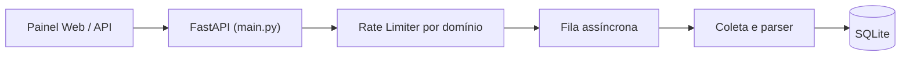

# CrawlMesh

Coletor web e monitor de preços escrito em Python com FastAPI, HTTPX, BeautifulSoup4 e SQLite. Faz download de páginas HTML, converte o conteúdo para Markdown, extrai dados estruturados (JSON-LD, OpenGraph e seletores CSS) e acompanha variações de preço em lojas online.

O coletor alterna cabeçalhos de navegador (`User-Agent` e `Sec-CH-UA`), aplica limite de requisições por domínio (token bucket) e controla uma lista de proxies com circuit breaker para isolar endpoints lentos ou fora do ar.

## Painel web

### Extrator (`/?tab=playground`)
Dispara coletas avulsas para qualquer URL. O retorno aparece ao lado em três formatos: Markdown, JSON com metadados e seletores, ou lista de links encontrados na página. O rodapé do formulário mostra o status HTTP, tempo de resposta, fingerprint e proxy usados na requisição.


### Preços monitorados (`/?tab=monitors`)
Lista os produtos cadastrados com preço atual, mínimo e máximo registrados, meta de alerta e histórico recente. Os valores são lidos de blocos `application/ld+json` (`Product`/`Offer`), meta tags `product:price:amount` ou expressões regulares para `BRL` e `USD`.


### Fila e proxies (`/?tab=fleet`)
Mostra as últimas coletas processadas e o estado dos proxies cadastrados (`CLOSED`, `HALF-OPEN` ou `OPEN`), com contagem de sucessos, falhas e latência média.


## Estrutura do código



O módulo `app/engine/fingerprint.py` monta combinações válidas de `User-Agent` (Chrome 131, Firefox 132, Edge 131) com os cabeçalhos `Sec-Ch-Ua`, `Sec-Ch-Ua-Platform` e `Accept-Language`. Em `app/engine/proxy_manager.py`, o gerenciador de proxies calcula a latência média móvel de cada nó, abre o circuito após falhas seguidas e retira o proxy de rotação até o fim do tempo de espera.

O controle de taxa fica em `app/engine/rate_limiter.py`, que mantém um token bucket por domínio para evitar erros `HTTP 429`. Quando o HTML chega, `app/engine/extractor.py` remove tags de script, estilo e navegação antes de converter o texto para Markdown, enquanto `app/engine/price_parser.py` extrai preços e disponibilidade de estoque.

## Como rodar

Localmente, o servidor usa SQLite e uma fila em memória com `asyncio`, sem precisar de serviços externos:

```bash
git clone https://github.com/Glawther/CrawlMesh.git
cd CrawlMesh

python -m venv .venv
# Windows
.venv\Scripts\activate
# Linux/macOS
source .venv/bin/activate

pip install -r requirements.txt
python main.py
```

O painel abre em `http://127.0.0.1:8090` e a documentação OpenAPI fica em `http://127.0.0.1:8090/docs`.

Para subir com Docker Compose (API, Redis e PostgreSQL):

```bash
docker compose up --build -d
```

## Exemplo de chamada na API

Requisição para extrair uma página de produto com seletores CSS e leitura de preço:

```bash
curl -X POST "http://127.0.0.1:8090/api/v1/crawl" \
  -H "Content-Type: application/json" \
  -d '{
    "url": "https://kabum.com.br/produto/rtx-4070-super-12gb",
    "mode": "price",
    "priority": "HIGH",
    "selectors": {
      "titulo": "h1",
      "oferta": ".price-tag"
    }
  }'
```

Resposta:

```json
{
  "job_id": "cm-9f82a104",
  "url": "https://kabum.com.br/produto/rtx-4070-super-12gb",
  "domain": "kabum.com.br",
  "status": "COMPLETED",
  "http_status": 200,
  "mode": "price",
  "title": "Placa de Vídeo RTX 4070 Super 12GB GDDR6X | KaBuM!",
  "price_intel": {
    "detected": true,
    "currency": "BRL",
    "amount": 3849.9,
    "formatted": "R$ 3.849,90",
    "in_stock": true,
    "source_method": "json-ld"
  },
  "fingerprint_used": "Chrome 131.0 / Windows 10 x64",
  "proxy_used": "br-sp-node01 (189.12.44.10:8080)",
  "elapsed_ms": 18.4
}
```

## Testes

Os testes cobrem a conversão de HTML para Markdown, leitura de JSON-LD e preços em BRL/USD, circuit breaker dos proxies, rate limiter e rotas HTTP:

```bash
pytest tests/ -v
```

## Licença

MIT.
