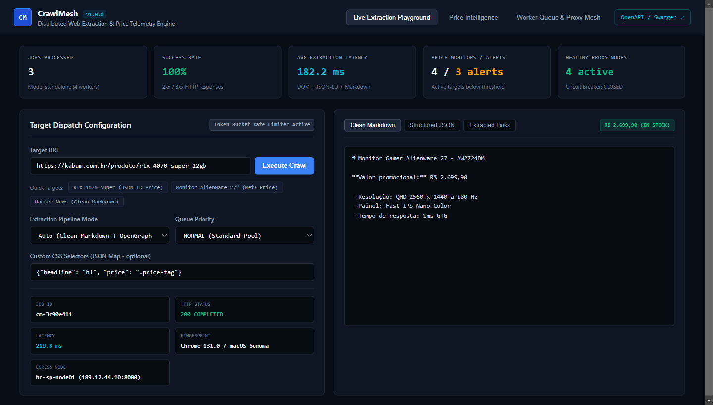
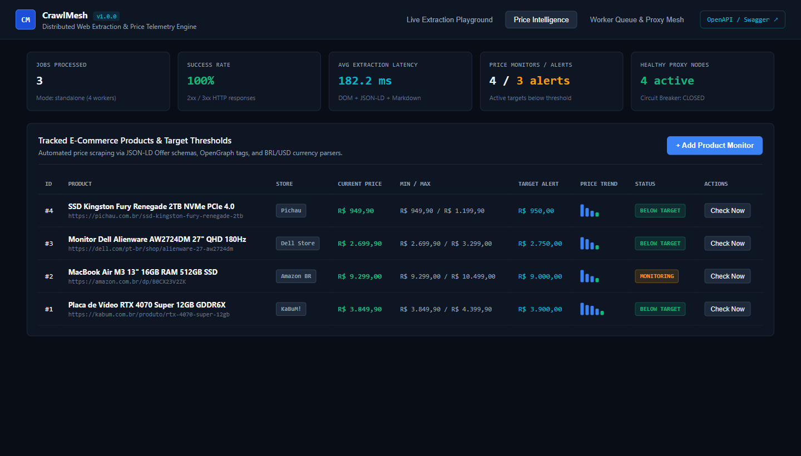
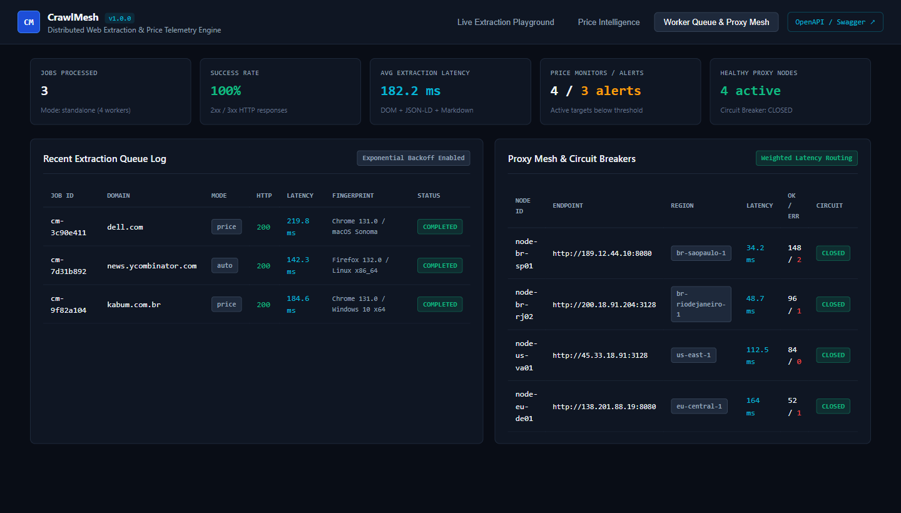
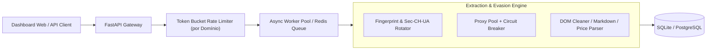

# CrawlMesh

Infraestrutura distribuída para extração de dados web, conversão de HTML em Markdown limpo e monitoramento contínuo de preços em e-commerces.

Construído em Python com **FastAPI**, **HTTPX Assíncrono**, **BeautifulSoup4**, **SQLite / PostgreSQL** e **Redis**, o CrawlMesh combina rotação de fingerprints de navegador, pool de proxies com *circuit breaker* e controle de taxa (*Token Bucket Rate Limiter*) por domínio.

---

## Interface e Operação

### 1. Live Extraction Playground (Markdown, JSON e Seletores CSS)
Permite disparar extrações em tempo real contra qualquer URL, inspecionando o retorno em Markdown limpo, JSON estruturado (OpenGraph, Schema.org, seletores customizados) ou lista de links, acompanhado da telemetria de latência, fingerprint e nó de saída utilizado.



### 2. Price Intelligence & Alertas de Queda
Monitora páginas de produtos extraindo preços automaticamente via blocos `application/ld+json` (Schema.org `Product`/`Offer`), meta tags `product:price:amount` ou expressões regulares monetárias (`BRL` / `USD`), mantendo série histórica de variações e sinalizando quando o valor atinge a meta definida.



### 3. Fila de Workers e Malha de Proxies (Circuit Breaker)
Acompanha o histórico de jobs processados pelo pool assíncrono com retentativa exponencial (*Exponential Backoff*) e o estado de saúde de cada proxy registrado (`CLOSED`, `HALF-OPEN`, `OPEN`), roteando tráfego pelos nós de menor latência.



---

## Arquitetura



### Componentes Principais

- **`app/engine/fingerprint.py`**: Gera pares consistentes de `User-Agent` (Chrome 131, Firefox 132, Edge 131) e cabeçalhos `Sec-Ch-Ua`, `Sec-Ch-Ua-Platform` e `Accept-Language`.
- **`app/engine/proxy_manager.py`**: Monitora a latência média móvel de cada proxy e abre o circuito automaticamente após falhas consecutivas, isolando proxies degradados por um período de *cooldown*.
- **`app/engine/rate_limiter.py`**: Implementa o algoritmo *Token Bucket* individualizado por domínio de destino para evitar saturação e bloqueios por excesso de requisições (`HTTP 429`).
- **`app/engine/extractor.py` & `price_parser.py`**: Remove ruído estrutural (`<script>`, `<style>`, `<nav>`, `<footer>`) gerando Markdown limpo para pipelines de dados/LLMs e extrai valores monetários e disponibilidade de estoque.

---

## Como Executar

O projeto opera em dois modos: **Standalone** (SQLite + fila em memória via `asyncio`, sem dependências externas) ou **Cluster** (via Docker Compose com PostgreSQL e Redis).

### Modo 1: Execução Local Direta (Standalone)

```bash
git clone https://github.com/Glawther/CrawlMesh.git
cd CrawlMesh

python -m venv .venv
# Windows
.venv\Scripts\activate
# Linux/macOS
source .venv/bin/activate

pip install -r requirements.txt
python main.py
```

Acesse o painel em `http://127.0.0.1:8090` e a documentação interativa OpenAPI em `http://127.0.0.1:8090/docs`.

### Modo 2: Docker Compose (API + Redis + PostgreSQL)

```bash
docker compose up --build -d
```

---

## Exemplo de Uso da API REST

### Extrair uma URL com seletores customizados e detecção de preço

```bash
curl -X POST "http://127.0.0.1:8090/api/v1/crawl" \
  -H "Content-Type: application/json" \
  -d '{
    "url": "https://kabum.com.br/produto/rtx-4070-super-12gb",
    "mode": "price",
    "priority": "HIGH",
    "selectors": {
      "titulo": "h1",
      "oferta": ".price-tag"
    }
  }'
```

### Resposta (JSON)

```json
{
  "job_id": "cm-9f82a104",
  "url": "https://kabum.com.br/produto/rtx-4070-super-12gb",
  "domain": "kabum.com.br",
  "status": "COMPLETED",
  "http_status": 200,
  "mode": "price",
  "title": "Placa de Vídeo RTX 4070 Super 12GB GDDR6X | KaBuM!",
  "price_intel": {
    "detected": true,
    "currency": "BRL",
    "amount": 3849.9,
    "formatted": "R$ 3.849,90",
    "in_stock": true,
    "source_method": "json-ld"
  },
  "fingerprint_used": "Chrome 131.0 / Windows 10 x64",
  "proxy_used": "node-br-sp01 (http://189.12.44.10:8080)",
  "elapsed_ms": 18.4
}
```

---

## Testes Automatizados

A suíte valida a limpeza de HTML para Markdown, extração de dados estruturados JSON-LD, regex monetário (BRL/USD), circuit breaker de proxies, token bucket rate limiter e rotas da API:

```bash
pytest tests/ -v
```

---

## Licença

Distribuído sob a licença MIT.
